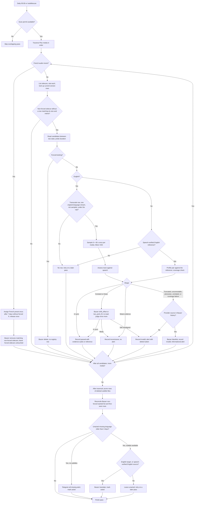

## 2. Problem Statement

Subtitle files reach the library from Bazarr downloads, Bazarr translations, and transcoding extraction, and some of them are wrong: a full-dialogue slot filled by a forced track, a track offset or drifting from the speech, a truncated track, or a track made for another cut or episode. Other media stay without subtitles for days because no provider has them, and French-audio media keep requesting full subtitles they never need. The feature is a scheduled, incremental scan that judges English tracks against sampled speech and other languages against a speech-verified English track, repairs what it can through Bazarr, blacklists or alerts on what it cannot, and keeps Bazarr's per-media language requests aligned with the audio actually played.

- `[G-1.1]` Analyze non-forced sidecars on episodes and movies without French preferred audio once per file identity (full path, size, and mtime) and scan version; never re-analyze a file whose current-version `passed`, `invalid`, or `inconclusive` row still matches its size and mtime.
- `[G-2.1]` Remove unwanted forced subtitles through Bazarr, and repair a constant offset or linear drift through Bazarr, verified in the same pass. A track that cannot be repaired, or is still misaligned after its repair, becomes `invalid`; a track whose evidence is too weak to decide becomes `inconclusive`.
- `[G-3.1]` For media missing subtitles for more than 3 days, alert on Telegram when none exist and translate through Bazarr when a usable source exists; a translation into a non-English language starts only from an English track verified against speech.
- `[G-4]` Keep only forced sidecars on French-audio movies: assign the Bazarr French preset, remove existing non-forced sidecars through Bazarr, and release the forced request after 7 days without one.
- `[G-5.1]` Judge every English sidecar against sampled speech of the media's original-language audio, alone or paired, once the transcode scan has passed the media, and judge every other language by text against a speech-verified English track. A track in sync with the audio is never `invalid` because of an unverified or differently segmented sibling. A pass samples at most once per media and at most `SPEECH_MEDIA_PER_PASS` media.
- `[G-6]` Stop Bazarr from downloading an invalid provider subtitle again: the scan blacklists a provider-downloaded track that is `invalid` without a repair attempt, and the Telegram delete button blacklists when Bazarr history names the provider.

## 3. Key Design Decisions

| Decision                          | Choice                                                                                                                                                                                                                                                                                                                                                                                                                                                                                                                                                                                                                                                                                                          | Rationale                                                                                                                                                                                                                                                                                                                                                                                                                                                                                                                               |
| --------------------------------- | --------------------------------------------------------------------------------------------------------------------------------------------------------------------------------------------------------------------------------------------------------------------------------------------------------------------------------------------------------------------------------------------------------------------------------------------------------------------------------------------------------------------------------------------------------------------------------------------------------------------------------------------------------------------------------------------------------------- | --------------------------------------------------------------------------------------------------------------------------------------------------------------------------------------------------------------------------------------------------------------------------------------------------------------------------------------------------------------------------------------------------------------------------------------------------------------------------------------------------------------------------------------- |
| `[KD-1]` Entry points             | Register `Subtitle Scan` on `0 5 * * *` and the `/subtitlescan` Telegram command as the manual trigger for the same pass.                                                                                                                                                                                                                                                                                                                                                                                                                                                                                                                                                                                       | Subtitle changes arrive through Bazarr on its own schedule; a daily pass is enough to honor 3-day and 7-day windows while keeping the library traversal off the 12-hour jobs. One command name means one owner, so this feature is the sole registrant of `/subtitlescan`.                                                                                                                                                                                                                                                              |
| `[KD-2.2]` Scan identity          | Key the scan registry by full subtitle path. A row counts only at the current `SUBTITLE_SCAN_VERSION` and while the file's size and mtime equal the stored ones; a row without a stored stat counts until a version bump rewrites it.                                                                                                                                                                                                                                                                                                                                                                                                                                                                           | Two re-downloaded files (The Good, the Bad and the Ugly fr, The Hateful Eight en) inherited the `invalid` verdict of the file they replaced. A stat detects a replacement without reading or hashing contents. Full paths distinguish matching basenames in different directories.                                                                                                                                                                                                                                                      |
| `[KD-3.3]` Registry scope         | Retain one latest record per `filePath`: scan version, verdict (`passed`, `invalid`, `inconclusive`), evidence (`audio` or `reference`, set on `passed`), and the size and mtime of the snapshot the verdict judged. Every written verdict is terminal for that file identity at that version; `sync_requested` stays in the enum but is no longer written.                                                                                                                                                                                                                                                                                                                                                     | `inconclusive` means insufficient evidence, not valid or invalid; caching it avoids sampling the same uncertain media every pass. Evidence lets the reference choice and the translation source require a speech-verified English track. A re-analysis replaces the path's row; identical contents at different paths remain independent.                                                                                                                                                                                               |
| `[KD-3.2]` Registry pruning       | After each traversal, delete rows whose file is missing while its parent directory exists.                                                                                                                                                                                                                                                                                                                                                                                                                                                                                                                                                                                                                      | Rows of deleted files would otherwise accumulate and keep deleted subtitles in the `/invalidsubtitles` listing. A missing directory more likely means an unmounted library than a deleted subtitle, so its rows are kept.                                                                                                                                                                                                                                                                                                               |
| `[KD-4.1]` Unwanted forced        | A forced-looking `.<lang>.srt` file (no `.forced.` marker) is neither judged nor a reference: it is deleted through Bazarr and leaves no row.                                                                                                                                                                                                                                                                                                                                                                                                                                                                                                                                                                   | A forced track in the full-subtitle slot hides the real gap from Bazarr; deleting through Bazarr rather than the filesystem updates its history so the language returns to the wanted list and is searched again. Files named `.forced.srt` are wanted by construction. Replacement search is left to Bazarr's wanted-search schedule.                                                                                                                                                                                                  |
| `[KD-5.1]` Pair comparison        | A non-English track is compared with the English reference by `profilePair` (`src/features/subtitle_scan/services/subtitle_profile.ts`): one offset per runtime segment from cue-start differences, with extra votes for cue pairs that share an anchor token (numbers and mid-sentence capitalised words, matched case-insensitively), tried at the common framerate ratios. The pair is `agree`, `constant`, `linear`, `piecewise`, `unrelated` (no determined segment at any ratio across at least 3 segments holding `PROFILE_MIN_CUES` reference cue starts, as for another episode), or `undetermined`, including any pair with fewer than 3 such segments. It replaces the 500 ms / 50 % cue-start rule. | In-sync translations segment cues differently and scored 0.46–0.50 on the old rule; The Room Next Door goes from 0.48 raw to 0.84 at −0.5 s. Anchors only vote: the share of anchors two tracks have in common ranges from 0.34 to 0.85 on same-media pairs and reaches 0.38 across Suits episodes, so a share threshold would condemn in-sync pairs.                                                                                                                                                                                   |
| `[KD-6.2]` Repair                 | A `constant` or `linear` shape is repaired through Bazarr mods, `shift_offset` for an offset and `two_point_fit` for a ratio, from the speech fit for English and from the profile fit for other languages. The file is then re-read and judged again in the same pass; no file is repaired twice in a pass. A repair needs a Bazarr subtitle reference for the path and a fresh stat equal to the judged snapshot. Autoscan no longer requests ffsubsync `sync`.                                                                                                                                                                                                                                               | Bazarr 1.6.2 applies mods synchronously: `PATCH /api/subtitles` returns after rewriting the file. Autoscan-requested syncs mostly failed (`scale 0.00`) or applied a wrong 0.96 or 1.04 scale; House of the Dragon S02E03 fits ratio 1.0426 with a 0.2 s residual.                                                                                                                                                                                                                                                                      |
| `[KD-7]` Missing-subtitle clock   | Persist the first time each `(bazarr item, language)` appears in Bazarr's wanted list and act once when that row is older than 3 days.                                                                                                                                                                                                                                                                                                                                                                                                                                                                                                                                                                          | Bazarr's wanted list is the authoritative "missing" signal for the configured profile but carries no age; a first-seen row gives a deterministic 3-day window and an `actedAt` marker makes the alert or translation happen once.                                                                                                                                                                                                                                                                                                       |
| `[KD-8]` French-audio identity    | A media is French-audio when its media-domain `preferredLanguage` is `fr`.                                                                                                                                                                                                                                                                                                                                                                                                                                                                                                                                                                                                                                      | `preferredLanguage` is the audio Plex plays (`src/features/language_sync/language_sync.spec.md`); it defaults to the original language, so French films and French-dubbed media are both covered by one rule.                                                                                                                                                                                                                                                                                                                           |
| `[KD-9]` Profile lifecycle        | Persist `(bazarr item, assignedAt, releasedAt)`; assign the preset once, release the profile after 7 days without a `fr` forced subtitle, and never reassign a released item.                                                                                                                                                                                                                                                                                                                                                                                                                                                                                                                                   | Without a terminal state the next pass would see French audio again and reassign the preset, producing a 7-day assign/release loop.                                                                                                                                                                                                                                                                                                                                                                                                     |
| `[KD-10.1]` Bazarr boundary       | Add a thin `src/integrations/bazarr` client exposing wanted lists, item lookup by path, subtitle sources from history, subtitle mods, translation, deletion, and blacklisting, and profile listing/assignment.                                                                                                                                                                                                                                                                                                                                                                                                                                                                                                  | Bazarr is a vendor; the integration owns HTTP shape and validation while the feature owns policy, matching the arr and Plex clients (`docs/project_structure.spec.md` `[PI-3]`).                                                                                                                                                                                                                                                                                                                                                        |
| `[KD-11.1]` Coverage              | English truncation is decided on speech: at least `UNCOVERED_MIN` informative windows starting at or after the last cue's end make the track `truncated`. A non-English track fails coverage when, after its profile and any repair, its last cue ends before `COVERAGE_MIN_FRACTION` of the runtime or more than `max(COVERAGE_MAX_OVERRUN)` past it, unless the English reference fails the same check.                                                                                                                                                                                                                                                                                                       | A pair profile only scores segments both tracks cover, so a truncated track can still `agree`; the check catches Mr. Nobody fr and Suits S02E01 fr (+10 % past runtime). Checking after the repair keeps a shifted but complete track repairable, and exempting a quirk the reference shares, such as a long final song, keeps it from condemning a track. The metadata-only gap policy this replaces could not tell a shifted translation from a missing tail.                                                                         |
| `[KD-12.1]` Speech sample         | Every English candidate is judged on sampled speech, alone or paired. A media is sampled only when `transcode_scans` holds a row for its path with its current original language, at any transcode version, and exactly one audio stream's language tag normalises to that language; otherwise its English candidates wait without rows. The sample decodes 8 windows of 40 s at 6 %, 18 %, …, 90 % of the runtime from that stream as 16 kHz mono and extracts speech with the pinned Silero VAD v5.1 model on ONNX Runtime Web 1.22.0.                                                                                                                                                                        | Subtitles in every language are timed to the original speech, and a dub's phrase timing differs; a passed transcode leaves the original-language stream tagged. Silero on a maintained ONNX Runtime Web, rather than an unmaintained WebRTC Node binding or full-media ASR, keeps the model and runtime pinned and offline. The audit decoded these windows for 44 media in 2 min 38 s. The feature reads `transcode_scans` through its own repository, keeping the no-feature-import rule (`docs/project_structure.spec.md` `[KD-2]`). |
| `[KD-13.1]` Verdicts              | `assessTrack` (`src/features/subtitle_scan/services/subtitle_alignment.ts`) correlates the speech and cue masks of each informative window over ±`SPEECH_MAX_OFFSET` and folds the windows into `aligned`, `constant`, `linear`, `truncated`, `uncorrectable`, or `inconclusive`. English: `aligned` → `passed` with evidence `audio`; `truncated` or `uncorrectable` → `invalid`; `inconclusive` → `inconclusive`. Other languages: `agree` with coverage → `passed` with evidence `reference`; `piecewise`, `unrelated`, or a coverage failure → `invalid`; `undetermined` → `inconclusive`. After a repair, the in-sync shape passes, a weak re-check is `inconclusive`, and anything else is `invalid`.     | A sampled pass is not proof of full-media correctness, and an unsure track must never alert. Verification inside the pass needs no pending state.                                                                                                                                                                                                                                                                                                                                                                                       |
| `[KD-14]` French-movie precedence | Apply the French profile policy before file analysis; remove every matching non-forced movie sidecar through Bazarr regardless of cached scan verdict, and skip normal file analysis for that movie.                                                                                                                                                                                                                                                                                                                                                                                                                                                                                                            | Changing the wanted profile alone does not remove existing full subtitles. A forced sidecar must remain untouched; a cached `passed` or pending `sync_requested` verdict must not keep an unwanted full sidecar.                                                                                                                                                                                                                                                                                                                        |
| `[KD-15.1]` Operator deletion     | Every invalid alert and the `/invalidsubtitles` listing carry one delete button per subtitle. Tapping it blacklists the subtitle in Bazarr when Bazarr history holds a provider and `subs_id` for the path, otherwise deletes it through Bazarr, and removes its row.                                                                                                                                                                                                                                                                                                                                                                                                                                           | The operator settles what the scan could not: a failed repair, a translation, or a failed blacklist. Bazarr 1.6.2's blacklist call deletes the file, records the entry, and starts a new search, so Bazarr does not download the same subtitle again; translated files have no provider and are deleted. The removed row makes the next download a new candidate.                                                                                                                                                                       |
| `[KD-16]` Audio cap               | The traversal keeps a pass-scoped set of sampled media and samples at most `SPEECH_MEDIA_PER_PASS` (60) media per pass. A sampling attempt counts toward the cap even when it fails, so no media is sampled twice in a pass. Past the cap, English candidates wait without rows; non-English candidates still proceed against a reference verified on an earlier pass.                                                                                                                                                                                                                                                                                                                                          | The version-3 bump makes every media with an English sidecar due at once (732 in the registry on 2026-11-17). Decoding measured 3.6 s per media; a cap of 60 bounds a pass and clears the backlog in about 13 passes.                                                                                                                                                                                                                                                                                                                   |
| `[KD-17]` Timing reference        | English is the timing reference. A media's reference is its English sidecar with a counting `passed` row with evidence `audio`, written in this pass or earlier, with the smallest path; `.en.srt` and `.eng.srt` both normalise to `en` and are each assessed on the same windows. Every non-English candidate, translation or not, is profiled against the reference; while there is none it gets no row and waits, but it is still read so the forced lifecycle runs. A Bazarr translation (latest history action 6) is judged like any track of its language.                                                                                                                                               | Desperate Housewives S01E04 English passed alone and unverified, was translated, then condemned the in-sync French replacement. Text against one speech-verified track is steadier than per-track speech correlation, and the sample is per media, so verifying every English track costs one sample per media once.                                                                                                                                                                                                                    |
| `[KD-18]` Automatic blacklist     | When a track is `invalid` without a repair attempt (a `truncated` or `uncorrectable` English track, or a non-English track that is `piecewise`, `unrelated`, or fails coverage) and Bazarr history holds a provider and `subs_id` for its path, the scan blacklists it and sends an informational alert without a delete button. A translation, a path without a provider entry, a failed history lookup or blacklist call, and a track still misaligned after its repair get the invalid alert with its delete button. A file that changed since its snapshot gets no request, no row, and no alert. The scan never deletes a file directly.                                                                   | Each of these verdicts cites evidence about that file; a bare delete would let Bazarr download the same file back. Bazarr writes translations with action 6 and no provider, so they cannot be blacklisted.                                                                                                                                                                                                                                                                                                                             |
| `[KD-19]` Translation source      | Translating into a non-English language uses only a non-forced English Bazarr subtitle whose path has a current-version `passed` row with evidence `audio` and a stored stat equal to the file's; without one the row stays unacted, without an alert, and is retried on later passes. Translating into English keeps the first non-forced Bazarr subtitle as source; the new English track is then judged on speech. The missing policy never samples speech and never writes `subtitle_scans`.                                                                                                                                                                                                                | The drifting Desperate Housewives French tracks were translated from drifting English tracks. Traversal runs before the missing policy, so an English track verified in the same pass is already usable.                                                                                                                                                                                                                                                                                                                                |

## 4. Principles & Intents

- `[PI-1.1]` Incremental by default — file analysis over a library whose sidecars all have counting current-version rows performs directory listings, registry lookups, and one stat per sidecar, without hashing or reading subtitle contents. Mutations are triggered by an unregistered path, a changed size or mtime, a scan-version bump, or an elapsed window.
- `[PI-2.1]` Bazarr owns subtitle files — deletion, blacklisting, offset and framerate mods, translation, and download are Bazarr requests; the feature never writes a subtitle file itself.
- `[PI-3]` Per-item resilience — a media, Bazarr, or filesystem failure is logged and the traversal continues, as in `src/features/language_sync/jobs/language.job.ts:20`.
- `[PI-4]` Act once — every time-window action (alert, translate, release) is recorded so a daily cadence never repeats it.
- `[PI-5]` Evidence per track — a verdict cites evidence about that file: speech for English, and the pair profile against a speech-verified English track for other languages. An unverified track neither passes nor condemns another.
- `[PI-6]` Abstain when unsure — weak evidence records `inconclusive`, which never alerts, repairs, or blacklists.

## 5. Non-Goals

- `[NG-1.1]` Local subtitle rewrites, transcription, translation-quality/content checks, full-media audio analysis, and speech assessment of non-English tracks. Speech evidence is sampled VAD on English tracks; neither timings nor sampled speech certify dialogue content.
- `[NG-2]` Choosing subtitle providers, scores, or languages beyond the profiles configured in Bazarr.
- `[NG-3]` Scanning subtitle streams embedded in the media container; only sidecar `.srt` files are analyzed.
- `[NG-4.1]` Reporting a per-pass summary to Telegram; only all-missing alerts, invalid-subtitle alerts, automatic-blacklist alerts, and replies to `/subtitlescan` and `/invalidsubtitles` are user-facing.

## 6. Caveats

- `[C-1]` Bazarr, Plex, and this service must see the same file paths; item lookup matches Bazarr's `path` against the Plex part path, like `src/integrations/arr/sonarr.service.ts:34`.
- `[C-2.1]` The forced heuristic requires the media duration, which comes from an ffprobe of the media file (`src/features/transcoding/services/helpers/subtitle.ts:18`). The probe runs only for episodes or non-French-audio movies with at least one candidate: a non-forced sidecar without a counting current-version row.
- `[C-3.1]` Non-English tracks stay unjudged and never alert while their media has no reference: no English sidecar, an English track that is `invalid` or `inconclusive`, a media that never passes the transcode scan (for example after `NoStreamsKeptError`), or a stream check that keeps failing. An `inconclusive` English track is terminal for its file, so it blocks its siblings until the file changes.
- `[C-4.1]` A same-path file with the stored size and mtime reuses the current-version verdict; a different size or mtime, a rename, or a version bump makes the path a candidate. A file whose stats differ around its read gets no row in that pass, and a file can still change between the last stat and Bazarr's rewrite. A verdict is not revisited when something it depends on changes later: a non-English `passed` row survives a later change of its English reference, and an English `passed` row survives a same-path replacement of the media file. Deleting the file removes its row after the next traversal (`[KD-3.2]`) or immediately through the delete action (`[KD-15.1]`).
- `[C-5.1]` Wanted lists, items, subtitles, and profiles (`/api/movies/wanted`, `/api/episodes/wanted`, `/api/subtitles`, `/api/system/languages/profiles`, `/api/movies`, `/api/episodes`) follow Bazarr 1.4; history, blacklist, and mod requests follow Bazarr 1.6.2's API and mod source as read on the host, not a live call. The integration validators pin the fields the feature reads and must be checked against the deployed version. Blacklisting starts an immediate Bazarr search, so a replacement can arrive within the same pass.
- `[C-6]` The French preset is resolved by name from `BAZARR_FRENCH_PROFILE`; a missing profile is logged and prevents assignment and cleanup for French movies without an existing profile row. Previously assigned or released French movies can still have non-forced sidecars removed. French movies skip normal file analysis; other media's scan and the missing-subtitle policy continue.
- `[C-7]` Releasing a profile sets the Bazarr item's language profile to none; Bazarr then stops listing it as wanted, so the `released` state lives only in this feature's table.
- `[C-8]` Missing-subtitle rows are removed when the `(item, language)` leaves Bazarr's wanted list, so a subtitle that later disappears restarts the 3-day clock.
- `[C-9.1]` A translation into English uses the first present non-forced subtitle of the item as source; a translation into another language uses a speech-verified English sidecar (`[KD-19]`). Bazarr chooses the translation engine. A translation whose history entry is gone, or that was made outside Bazarr, counts as an original: its checks are the same, only the blacklist attempt differs.
- `[C-10.1]` Thresholds are constants in `src/features/subtitle_scan/constants.ts`, without environment settings, and are in-sample: one library, 44 media, English and French, with Whisper word timestamps standing in for Silero output. Tuning against the audit corpus set `AGREE_TOLERANCE` to 1.5 s, `PROFILE_SMOOTH` to 0.2 s, `SEGMENT_PEAK_RATIO` to 1.2, `ALIGNED_MIN_R` to 0.41, `MARGIN_MIN` to 0.05, and `REPAIR_MAX_RESIDUAL` to 1 s; 19 of the 22 audited in-sync English tracks are `aligned`, above the floor of 18 that `[VC-9.1]` sets. Silero on ONNX Runtime Web runs offline in a compiled macOS arm64 binary (`tests/integrations/ffmpeg/compiled.spec.ts`). On Linux, the `speech-offline` flake check runs the same smoke in the network-less build sandbox; CI builds it with the x86_64 package. `[VC-14]` and `[VC-17]` gate shipping the audio parts.
- `[C-11.1]` Eight 40 s windows cannot certify unsampled scenes: a local defect between windows can pass. Small drifts under about 3 s tend to stay `inconclusive`, and a drift that is not a framerate ratio smears each window: Desperate Housewives S01E04 en (about 5.4 %) comes out `inconclusive`, not `linear`. Neither timings nor VAD prove which dialogue a track carries.
- `[C-12]` The transcode precondition accepts a row at any transcode version and inherits that registry's same-path reuse (`src/features/transcoding/transcoding.spec.md` `[C-5]`): a media replaced at the same path without a new transcode check is sampled on the old layout's assumption.
- `[C-13]` The version-3 bump re-reads about 1,430 sidecars once and samples every media with an English sidecar and a transcode row, 60 per pass: an estimated 1–5 hours of host time spread over about 13 passes. A media whose sampling keeps failing consumes a cap slot on every pass; there is no retry scheduler.

## 7. High-Level Components

Per-media judgment is detailed under Analysis service.



| Component                | Module type                        | Responsibility                                                                                                                                          | Public API surface                                                                                 |
| ------------------------ | ---------------------------------- | ------------------------------------------------------------------------------------------------------------------------------------------------------- | -------------------------------------------------------------------------------------------------- |
| Scan job                 | Effect job + Telegram command      | Traverse Plex media, run the three policies per item, bound speech sampling per pass, and prune the registry under one permit                           | `runSubtitleScan`, `/subtitlescan`                                                                 |
| Scan registry            | Row types + repository             | Persist analyzed file identities, missing first-seen rows, and profile lifecycle                                                                        | `SubtitleScan`, `MissingSubtitle`, `FrenchProfile`, repository functions                           |
| Transcode precondition   | Repository                         | Read `transcode_scans` to decide whether a media may be sampled                                                                                         | `hasTranscodeScan`                                                                                 |
| Analysis service         | Effect service                     | Judge candidate tracks (English on sampled speech, other languages against the English reference) and request Bazarr repairs, deletions, and blacklists | `scanMediaSubtitles`                                                                               |
| Track judgment           | Pure functions                     | Parse cues, profile a pair of tracks, and assess a track against speech windows                                                                         | `parseCues`, `profilePair`, `assessTrack`                                                          |
| Speech boundary          | FFmpeg integration + Silero VAD    | Decode bounded windows of a chosen audio stream and return speech intervals, without rewriting subtitles                                                | `sampleSpeech`, `SpeechWindow`                                                                     |
| Invalid-subtitle actions | Telegram command + callback action | List current-version invalid paths and blacklist or delete a chosen one through Bazarr                                                                  | `/invalidsubtitles`, `subtitle_delete` action                                                      |
| Missing policy           | Effect service                     | Reconcile wanted list with first-seen rows and act after 3 days                                                                                         | `applyMissingPolicy`                                                                               |
| French profile policy    | Effect service                     | Assign/release the French preset and remove existing non-forced movie sidecars via Bazarr                                                               | `applyFrenchProfilePolicy`                                                                         |
| Bazarr client            | Integration                        | Typed Bazarr HTTP surface                                                                                                                               | `IBazarrClient`, `Bazarr` service key, `BAZARR_API_URL`, `BAZARR_API_KEY`, `BAZARR_FRENCH_PROFILE` |

## 8. Detailed Design

### Scan job

`runSubtitleScan` acquires a single scan permit (an item is skipped, not queued, when a pass is running), reads Plex sections and media, resolves `getCompleteMediaDetails` per item, and applies `applyFrenchProfilePolicy` first for French-audio movies, skipping `scanMediaSubtitles` for them; other media run `scanMediaSubtitles`. `pruneMissingScans` and then `applyMissingPolicy` run once per pass after traversal, even when traversal fails; the missing policy runs there because it is driven by Bazarr's wanted list rather than by Plex items. Non-interruption failures per item are logged with the media title and the loop continues; the job's own failure is logged at the scheduler boundary.

Each pass traverses every Plex section and analyzes every media item with candidate non-forced subtitle paths: sidecars without a counting current-version row (`[KD-2.2]`). French-audio movies skip file analysis, even when cleanup fails. Media whose sidecars all have counting rows are skipped after one stat per sidecar, without content reads. The pass keeps the set of media it has sampled and stops sampling at `SPEECH_MEDIA_PER_PASS` (`[KD-16]`); English candidates past the cap wait for a later pass. Analysis failures leave paths unregistered, so the next pass retries them. Missing-subtitle reconciliation, translations, and alerts remain library-wide and run after traversal.

- `[SO-4.1]` One pass analyzes every candidate path across all sections; French-audio movies and media whose sidecars all have counting current-version rows skip analysis — demonstrated by `[VC-5]` and `[VC-12.1]`.
- `[VC-5]` Job tests verify a single pass analyzes all new candidates across sections, skips French-audio, cached, and forced-only media, continues past metadata and analysis failures, and a following manual pass retries only the failed path — demonstrates `[SO-4.1]`. Terminal inconclusive eligibility is additionally covered by `[VC-12.1]`.

`/subtitlescan` submits the same pass to `BackgroundTasks`, replies `Starting subtitle scan...` or `A subtitle scan is already running.` according to permit admission, and returns `{ step: 'idle' }`; it produces no report (`[NG-4.1]`).

### Scan registry

The feature owns `SUBTITLE_SCAN_VERSION = 3`, a positive integer constant shared by `/subtitlescan` and the scheduled pass. Version 3 introduced the speech and pair-profile verdicts, Bazarr repairs, and blacklisting; its bump re-analyses every sidecar once (`[C-13]`). After a bump, the next pass treats every path without a row at the new version as a candidate, including old `passed`, `sync_requested`, or `invalid` paths. Old verdicts are neither skip signals nor references. A bump does not launch a pass itself; the schedule or command does.

Version bumps increase monotonically and are not reused; compatible relaxations may retain the current version. A row is valid only when its stored version matches the current version; a successful re-analysis replaces the row for that path with the new version and verdict, so no historical versions are retained and no registry purge is needed. The version is not a Telegram argument or environment setting. It does not reset `missingSubtitles` clocks/action markers or `frenchProfiles` lifecycle state, and it does not invalidate transcode results.

```sql
-- migrations/20261118120000_subtitle_identity
ALTER TYPE "subtitle_verdict" ADD VALUE 'inconclusive';
CREATE TYPE "subtitle_evidence" AS ENUM ('audio', 'reference');
ALTER TABLE "subtitle_scans"
  ADD COLUMN "file_size" bigint,
  ADD COLUMN "file_mtime" timestamp,
  ADD COLUMN "evidence" "subtitle_evidence";
```

```ts
// src/database/schema.ts
export interface SubtitleScan {
  filePath: string // primary key
  scanVersion: number
  scannedAt: Date
  verdict: 'passed' | 'sync_requested' | 'invalid' | 'inconclusive' // sync_requested is no longer written
  evidence: 'audio' | 'reference' | null // set when verdict = 'passed' at version ≥ 3
  fileSize: number | null // stat of the judged snapshot; null on rows written before version 3
  fileMtime: Date | null
}

export interface MissingSubtitle {
  bazarrKind: 'movie' | 'episode' // primary key with bazarrId and language
  bazarrId: number // radarrId or sonarrEpisodeId
  language: ISOCode1
  firstSeenAt: Date
  actedAt: Date | null
}

export interface FrenchProfile {
  bazarrKind: 'movie' | 'episode' // primary key with bazarrId
  bazarrId: number
  assignedAt: Date
  releasedAt: Date | null
}
```

Repository functions follow `src/domains/media/repositories/media.repository.ts`: each runs a Bun SQL query in `Database.use` and maps rejections to `DatabaseQueryError`. Lookups require both `filePath` and the current scan version; the caller then compares the stored size and mtime with a fresh stat (`isCounting` in `src/features/subtitle_scan/services/scan_registry.service.ts`). `subtitle_scans` writes use `ON CONFLICT (file_path) DO UPDATE` with every non-key column from `EXCLUDED`, replacing the entire row after a successful analysis so each full path has one latest record. Row types live in `src/database/schema.ts` and the tables are created by migrations under `migrations/`. `migrations/20260921190858_scan_path_primary_keys` updates both scan tables, retaining the latest record per full path by `scanned_at DESC, ctid DESC` before making inline `filePath` its sole primary key.

Records survive restarts and have no time-based expiry. Scheduled and manual passes use the same registry: a path whose row counts is not analyzed again. A row stores the stat of the snapshot it judged: after a repair, the re-read's, so a repaired file is not a candidate on the next pass; after a blacklist, the judged snapshot's, so the deleted file's row is pruned and a replacement at the same path is a new identity. Only `passed` English rows with evidence `audio` serve as references (`[KD-17]`). Forced-looking sidecars deleted through Bazarr leave no row, so a later file at that path is a new candidate. A path whose file was deleted loses its row on the next pass when its parent directory still exists, or immediately through the delete action; a later file at that path is then a new candidate. Failed or interrupted analysis never records a verdict, and a failed registry write leaves the path eligible for a later pass.

`migrations/20260923115940_invalid_subtitle_verdict` added `invalid`, and `migrations/20261118120000_subtitle_identity` adds `inconclusive`, the evidence enum, and the nullable stat and evidence columns, both without changing existing rows; `sync_requested` stays in the enum. Rollback is compatible for code and schema only: version-2 code ignores the new columns and filters by version, so version-3 rows, including `inconclusive`, are invisible to it. Because each path keeps one row, version-3 rows have replaced version-2 rows, so rolled-back code re-analyses those files with version-2 behaviour, including sync requests. Repairs, deletions, and blacklist entries made through Bazarr are not undone. Pause the Subtitle Scan job before rolling back if that re-analysis is unwanted.

This registry is independent of the passed-file registry in `src/features/transcoding/transcoding.spec.md`, except that the scan reads `transcode_scans` as a precondition for sampling speech (`[KD-12.1]`), through its own `src/features/subtitle_scan/repositories/transcode_scan.repository.ts` (`hasTranscodeScan(filePath, originalLanguage)`, any transcode version). A successfully checked media file skips further transcode analysis for that identity, not subtitle analysis or the missing/French policies. Transcoding never marks extracted sidecars as passed: new sidecar paths enter this scan as candidates. Conversely, a passing subtitle does not certify the media's transcode criteria.

### Analysis service

For media other than French-audio movies, `scanMediaSubtitles` (`src/features/subtitle_scan/services/subtitle_scan.service.ts`) lists sibling files `<base>.<lang>.srt` and `<base>.<lang>.forced.srt` in the media directory, then:

```text
candidates ← sidecars without a `.forced.` marker and without a counting row   # one stat per sidecar ([KD-2.2])
if candidates is empty → return              # no content reads, probe, Bazarr lookup, or audio
item ← Bazarr item of the media; none → log a warning, return
read each candidate between two stats; stats differ → dropped for this pass
duration ← ffprobe(media)
forced-looking candidates → bazarr.deleteSubtitle; no row; dropped below          ([KD-4.1])
english ← remaining candidates in REFERENCE_LANGUAGE
if english is non-empty, the media has a transcode row for its original language,
   exactly one audio stream is tagged with that language, the media is not yet
   sampled this pass, and the cap is not reached                       ([KD-12.1], [KD-16]):
  add the media to the sampled set; windows ← sampleSpeech(media, that stream, 8 × 40 s)
  for each English candidate: judge(assessTrack(track, windows))
otherwise English candidates wait without rows (a warning when the stream check fails)
reference ← English sidecar with a counting passed/audio row, smallest path ([KD-17]); none → others wait
read the reference between two stats if not yet read; stats differ → others wait
for each non-English candidate: judge(profilePair(reference, track, duration), coverage) ([KD-5.1], [KD-11.1])

judge:
  in sync (aligned, or agree with coverage) → passed with evidence audio or reference
  constant | linear                         → modifySubtitle(fit); re-read; judge once more, without repair:
                                              in sync → passed; weak → inconclusive; otherwise → invalid, alert
  weak (inconclusive, undetermined)         → inconclusive
  otherwise                                 → invalid, blacklist ([KD-18])
```

Each verdict is persisted with its snapshot's stat (`[KD-3.3]`). A repair or blacklist runs only when a fresh stat equals the snapshot's; a file that changed gets no Bazarr request, no row, and no alert. History sources are fetched at most once per media. A failure for one track (read, stat, Bazarr repair, I/O) leaves that track without a row and the pass continues with the next track; a failure for the English reference makes the non-English candidates wait. A failure for the media (ffprobe, the transcode lookup, the audio-stream probe, `sampleSpeech`) leaves every candidate of the media without a row. Rows written earlier stay, and interruption propagates. A failed blacklist call is not a failure: the `invalid` row persists and the alert keeps its delete button. Classification rules live in `src/features/subtitle_scan/services/subtitle_profile.ts` and `src/features/subtitle_scan/services/subtitle_alignment.ts`, and their thresholds in `src/features/subtitle_scan/constants.ts` (`[C-10.1]`). `parseCues` and the forced heuristic handle LF and CRLF.

```ts
// src/integrations/ffmpeg/ffmpeg.service.ts — read-only
interface SpeechWindow {
  readonly start: number // media seconds
  readonly duration: number
  readonly speech: readonly (readonly [number, number])[] // media seconds
}
readonly sampleSpeech: (
  input: string,
  audioStream: number, // index among audio streams, as in `-map 0:a:<n>`
  windows: readonly { start: number; duration: number }[]
) => Effect.Effect<SpeechWindow[], FfmpegError | SpeechActivityError>
```

The service chooses the audio stream from ffprobe's audio streams and their `language` tags: the one stream whose tag normalises to the media's original language, never `preferredLanguage`, the first stream, or a subtitle's language. `sampleSpeech` decodes each window of that stream as 16 kHz mono float32 PCM into a scoped temporary file, never through the text-collecting command helper, and runs Silero VAD (`src/integrations/ffmpeg/silero.ts`) with fresh recurrent state and context per window. The pinned Silero v5.1 model, its license, and its hashes live in `src/integrations/ffmpeg/silero/`; `onnxruntime-web` 1.22.0 runs on its WASM backend with one thread and no proxy worker, and the model and runtime assets are embedded in compiled binaries, so nothing downloads at runtime. Temporary files are removed on success, failure, and interruption, which propagates. Speech is sampled once per media per pass and shared by its English candidates; there is no persistent cache and no transcription. Logs carry per-window numbers and the selected stream, never cue text.

Persist `invalid` before sending the existing best-effort plain-text message to `TELEGRAM_CHAT_ID`: `Invalid subtitle for <media title> (<language>)`, with a `🗑️ Delete` button for that file (`[KD-15.1]`). After an automatic blacklist the message is instead `Blacklisted invalid subtitle for <media title> (<language>); Bazarr is searching for another.`, without a button (`[KD-18]`). Only the affected file alerts, at most once per file identity and version; `passed`, `inconclusive`, and repairs send no notification, and no message carries a file path. Telegram failure does not change the persisted verdict or stop other candidates; failed alerts are not retried.

### Invalid-subtitle actions

`/invalidsubtitles` replies `No invalid subtitles.` or `Invalid subtitles (tap to delete through Bazarr):` with one `🗑️ <file name>` button per current-version `invalid` path, ordered by path. Each button, like the invalid alert's, sends `subtitle_delete:<key>`, where the key is a base-36 `Bun.hash` of the full path because Telegram limits callback data to 64 bytes. The action answers the callback, then replies with the first matching outcome:

| Situation                                                  | Effect                                                                          | Reply                                                    |
| ---------------------------------------------------------- | ------------------------------------------------------------------------------- | -------------------------------------------------------- |
| No current-version invalid path matches the key            | none                                                                            | `This subtitle is no longer marked invalid.`             |
| The file no longer exists                                  | remove the row                                                                  | `<file name> was already deleted.`                       |
| The file's size or mtime differs from the row              | none                                                                            | `This subtitle is no longer marked invalid.`             |
| Bazarr has no item or subtitle at that path                | keep the file and row; log a warning                                            | `Bazarr does not track <file name>; it was not deleted.` |
| Bazarr history holds a provider and `subs_id` for the path | Bazarr blacklists the subtitle, deleting it and searching again; remove the row | `Deleted <file name>.`                                   |
| Otherwise                                                  | Bazarr deletes the subtitle; remove the row                                     | `Deleted <file name>.`                                   |

The Bazarr item is resolved from the sibling media file `<base>.<video extension>`, trying the episode lookup before the movie lookup. A Bazarr failure (history lookup, blacklist, or delete) leaves the row in place and surfaces through the Telegram provider's generic error reply.

### Missing policy

```text
wanted ← bazarr.getWantedMovies() ++ bazarr.getWantedEpisodes()
rows ← repository.listMissing()
for each (item, lang) in wanted with lang not forced: upsert first_seen_at = now on absence
delete rows whose (item, lang) is not in wanted
for each row with first_seen_at < now - 3d and acted_at is null:
  item ← wanted[row]
  if item.subtitles (non-forced) is empty:
    telegram.sendMessage(TELEGRAM_CHAT_ID, "No subtitles for <title> after 3 days (missing: en, fr)")   # once per item, not per language
  else:
    source ← row.language = en ? first non-forced item subtitle
                               : non-forced en subtitle with a counting passed/audio row, smallest path   # [KD-19]
    if source is none → leave unacted; continue          # no request, no alert, no translation slot
    if fewer than 3 translation requests have been made this pass:
      bazarr.translateSubtitle(item, source, target = row.language)
      set acted_at = now on success
  else set acted_at = now after a successful alert
```

The all-missing alert groups every unacted row of one item into one message and marks all of them acted. At most three translation requests (including failed requests) are sent per pass across movies and episodes; excess rows stay unacted until a later pass. Alerts and rows waiting for a verified English source do not consume translation slots. A Bazarr or Telegram failure leaves `actedAt` null so the action is retried on the next pass. The policy never samples speech and never writes `subtitle_scans`.

### French profile policy

```text
if details.mediaType ≠ movie or details.preferredLanguage ≠ 'fr' → return
item ← bazarr.getMovieByPath(details.file)
if item is missing → log; return  # retry cleanup on next pass; do not run normal analysis
row ← repository.getFrenchProfile(item)
if row = undefined:
  if frenchPresetId is missing → log; return  # do not delete before assigning the wanted profile
  bazarr.setProfile(item, frenchPresetId); insert assigned_at = now
else if row.released_at = null and no `<base>.fr.forced.srt` exists and row.assigned_at < now - 7d:
  bazarr.setProfile(item, none); set released_at = now
for each existing sidecar `<base>.<lang>.srt` with a matching non-forced Bazarr subtitle path:
  bazarr.deleteSubtitle(item, subtitle)  # regardless of scan verdict; never delete `.forced.srt`
```

The preset id is resolved once per pass from `bazarr.getProfiles()` by the name in `BAZARR_FRENCH_PROFILE`. Profile assignment (or an existing assigned/released row) precedes deletion. Only exact matching Bazarr subtitle paths are removed; missing matches and failed deletes are logged and remain eligible on later passes. A French-audio movie never enters forced, speech, profile, repair, or blacklist analysis, whatever its scan row. Because the French preset requests only `fr:forced`, the missing policy's non-forced filter (`[KD-7]`) never alerts or translates for these items after assignment.

### Bazarr client

```ts
export interface IBazarrClient {
  readonly getWantedMovies: Effect.Effect<BazarrItem[], HttpClientError>
  readonly getWantedEpisodes: Effect.Effect<BazarrItem[], HttpClientError>
  readonly getMovieByPath: (filePath: string) => Effect.Effect<BazarrItem | undefined, HttpClientError>
  readonly getEpisodeByPath: (filePath: string) => Effect.Effect<BazarrItem | undefined, HttpClientError>
  readonly getProfiles: Effect.Effect<{ profileId: number; name: string }[], HttpClientError>
  readonly setProfile: (item: Extract<BazarrItemRef, { kind: 'movie' }>, profileId: number | null) => Effect.Effect<void, HttpClientError>
  readonly deleteSubtitle: (item: BazarrItemRef, subtitle: BazarrSubtitleRef) => Effect.Effect<void, HttpClientError>
  readonly modifySubtitle: (item: BazarrItemRef, subtitle: BazarrSubtitleRef, fit: SubtitleFit) => Effect.Effect<void, HttpClientError>
  readonly getSubtitleSources: (item: BazarrItemRef) => Effect.Effect<ReadonlyMap<string, SubtitleSource>, HttpClientError> // by subtitle path
  readonly blacklistSubtitle: (
    item: BazarrItemRef,
    subtitle: BazarrSubtitleRef,
    source: Extract<SubtitleSource, { kind: 'provider' }>
  ) => Effect.Effect<void, HttpClientError>
  readonly translateSubtitle: (item: BazarrItemRef, source: BazarrSubtitleRef, target: ISOCode1) => Effect.Effect<void, HttpClientError>
}

type BazarrItemRef = { kind: 'movie'; id: number } | { kind: 'episode'; id: number; seriesId: number } // radarrId | sonarrEpisodeId
interface BazarrSubtitleRef {
  language: ISOCode1
  forced: boolean
  hi: boolean
  path: string
}
type BazarrItem = BazarrItemRef & {
  title: string
  path: string
  subtitles: BazarrSubtitleRef[]
  missingSubtitles: { language: ISOCode1; forced: boolean }[]
}
type SubtitleSource = { kind: 'provider'; provider: string; subsId: string } | { kind: 'translation' }
// The track's times relate to the reference's as t_track ≈ ratio · t_ref + offset; the mod applies t ↦ (t − offset) / ratio.
interface SubtitleFit {
  readonly offset: number // seconds; > 0 means the track is late
  readonly ratio: number
}
```

The client is built on `httpClient` with header `X-API-KEY` and base `${BAZARR_API_URL}/api`, registered as a `Bazarr` service key in `src/core/runtime.service.ts` and constructed in the composition root beside the arr clients. Profile assignment maps to `POST /movies` with `profileid`; deletion to `DELETE /movies/subtitles` or `DELETE /episodes/subtitles`; translation and mods to `PATCH /subtitles` with `action` `translate`, `shift_offset(…)` when `ratio = 1`, or `two_point_fit(…)` otherwise (exact arguments in `fitAction`, `src/integrations/bazarr/bazarr.service.ts`). `getSubtitleSources` reads `GET /movies/history?radarrid=` or `GET /episodes/history?episodeid=`: per `subtitles_path`, the latest entry with action 1, 2, 3 (downloaded, manual, upgraded) or 6 (translated); action 6 maps to `translation`, actions 1–3 map to `provider` when `provider` and `subs_id` are non-empty, and otherwise the path is absent. `blacklistSubtitle` maps to `POST /movies/blacklist` (`radarrid`) or `POST /episodes/blacklist` (`seriesid`, `episodeid`) with `provider`, `subs_id`, `language`, and `subtitles_path`. The client has no sync request. Responses are validated with co-located Effect Schemas that read only the fields above. `BAZARR_API_KEY` supports the `_FILE` secret convention (`src/config/env.ts:3`).

### Timing and notification acceptance

Fixtures are timing-only: cue intervals, per-cue anchor tokens, and speech intervals. They contain no dialogue and no audio, except the generated speech fixture under `tests/fixtures/speech/`.

- `[SO-1.1]` A track in sync with the audio is not marked `invalid` because of an unverified or differently segmented sibling, and CRLF sidecars parse like LF files — demonstrated by `[VC-10.1]`, `[VC-9.1]`, and `[VC-2]`.
- ~~`[VC-1]`~~ Withdrawn with the 500 ms cue-start rule (`[KD-5.1]`).
- `[VC-2]` LF and CRLF representations produce identical cue starts and forced verdicts — demonstrates `[SO-1.1]`.
- `[SO-3.1]` English is the timing reference: every English track is judged on speech, alone or paired, including tracks that passed at version 2; other languages are judged only against a speech-verified English track and wait without a row otherwise; a translation into a non-English language starts only from such a track — demonstrated by `[VC-19]` and `[VC-21]`.
- `[VC-4.1]` Service tests verify the configured recipient, the exact invalid-alert and automatic-blacklist texts with media title and subtitle language, the absence of a file path, a delete button only on the invalid alert, no notification for `passed`, `inconclusive`, or a repair, no repeated alert or content read for a counting path, and continued scanning with persisted verdicts after Telegram failure — demonstrates `[SO-6.1]` and `[SO-10.1]`.
- `[SO-5.1]` A file whose current-version row matches its size and mtime skips hashing and content reads across passes and restarts; a different file at a registered path is analyzed again, and a file that changes during a pass is neither mutated nor registered — demonstrated by `[VC-6.1]`, `[VC-7]`, and `[VC-12.1]`.
- `[VC-6.1]` A row whose stored size or mtime differs from the file makes the path a candidate; a matching row skips it without reading the file; a repaired file is not a candidate on the next pass; renamed paths and identical contents at different paths are independently eligible. A file whose stats differ around its read gets no row; a file whose stat changes before a repair or blacklist gets no `PATCH` or `POST`, no row, and no alert; a blacklisted file's row stores the judged stat, so a replacement at the same path is a candidate — demonstrates `[SO-5.1]`.
- `[VC-7]` `tests/features/subtitle_scan/repositories/subtitle_scan.repository.spec.ts` verifies that a version-change upsert replaces the full row for a path; the combined migration regression is covered by `tests/features/transcoding/repositories/transcode_scan.repository.spec.ts` — demonstrates `[SO-5.1]`.

- `[SO-6.1]` Constant offsets and linear drifts are repaired through Bazarr and verified in the same pass; truncated tracks, other cuts, other episodes, coverage failures, and failed repairs become `invalid`, and weak evidence becomes `inconclusive` — demonstrated by `[VC-8.1]`, `[VC-9.1]`, `[VC-18]`, and `[VC-12.1]`.
- `[VC-8.1]` A Hateful Eight-style truncated English track (speech in at least 2 windows after its last cue) is `truncated` and `invalid` without a repair request. An other-episode French track (`unrelated`), a piecewise French track, and a French track ending at 46 % of the runtime against a reference that covers it are `invalid` without a repair request. A French track 100 s late on an episode whose reference ends 20 s before the runtime is repaired and `passed`, not `invalid`. An English track with fewer than 4 informative windows is `inconclusive` without an alert — demonstrates `[SO-6.1]`.
- `[VC-9.1]` Replaying `tests/fixtures/subtitle_scan/audit_corpus.txt` (corpus ids in parentheses): none of the 22 audited in-sync English tracks is `truncated`, `uncorrectable`, `constant`, or `linear`, and at least 18 of them are `aligned` (19 at the `[C-10.1]` values). House of the Dragon S02E03 en (`m23`) is `linear` with ratio 1.0426 ± 0.002 and offset −52.2 ± 1 s; Fleabag S01E05 en (`m22`) is `constant` at +87.8 ± 0.5 s; The Hateful Eight en (`m11`) is `truncated`; Desperate Housewives S01E04 en (`m16`) is not `aligned`. House of the Dragon fr profiled against `m23` en corrected by its fit is `linear` with a ratio within 0.002 of the English one. The French tracks of `m03`, `m10`, `m12`, `m13`, `m24`, and `m43` profile `agree` against their English tracks, and Interstellar from `real_intervals.txt` profiles `agree`. Synthetic English tracks built from the 22 in-sync English tracks against their own media's windows: shifts of +2.6, +5.0, −34.5, and +43.9 s are never `aligned` and at least half are `constant` within ±0.5 s; ratio 1.0425 with offset −52 s, on media shorter than 4,000 s, is never `aligned` or `constant`; quarters shifted by 0, +31, +48, and +66 s, cues cut at 46 % of the runtime, and the cues of another Suits episode are never `aligned`; no synthetic track yields a fit more than 1 s from the applied shape at any window. Synthetic French tracks built from the six French tracks above against their English tracks: the same shifts profile `constant` within ±0.5 s; ratio 25/23.976 profiles `linear` within ±0.002; the quarter shifts profile `piecewise`; cues cut at 46 % profile `agree` and fail the coverage check; the French track of another Suits episode against each Suits English track is `unrelated` or `undetermined` — demonstrates `[SO-1.1]` and `[SO-6.1]`.
- `[SO-7.1]` Audio costs at most one bounded sample per media per pass, only for an English candidate of a media the transcode scan has passed, only from its original-language stream, and for at most `SPEECH_MEDIA_PER_PASS` media per pass, using a pinned Silero runtime that works offline in the compiled binary — demonstrated by `[VC-11.1]` and `[VC-17]`.
- `[VC-10.1]` Given a speech-aligned English track paired with (a) a drifting, (b) an other-cut, and (c) an other-episode French sibling, the English track is recorded `passed` with evidence `audio` and gets no alert; given (d) an in-sync resegmented French track (The Room Next Door timings) against an aligned English track, the French track is `passed` with evidence `reference` — demonstrates `[SO-1.1]`.
- `[VC-11.1]` Across a pass, `sampleSpeech` is called at most once per media, with 8 windows of 40 s, only for media with an English candidate, and for at most `SPEECH_MEDIA_PER_PASS` media; a failed sample counts toward the cap and is not retried in the pass; a media past the cap keeps no English rows and is sampled on a later pass; a media whose only candidate is French, with a reference verified earlier, is not sampled. A media without a `transcode_scans` row for its path, or whose row holds another original language, gets no `sampleSpeech` call and no English row. A media whose row matches, with Japanese original audio at stream 0 and English at stream 1, is sampled on stream 0; a media with no stream, or two streams, tagged with its original language gets no `sampleSpeech` call, no English row, and a warning — demonstrates `[SO-7.1]`.
- `[VC-12.1]` An `inconclusive` verdict (an English track with fewer than `INFORMATIVE_MIN` informative windows, an `undetermined` profile, or a weak re-check after a repair) persists without an alert, repair, or blacklist, and later passes skip its reads and audio while the file is unchanged. A failure for one track leaves it without a row while the pass continues; a failure for the media (ffprobe, the transcode lookup, the audio-stream probe, `sampleSpeech`) leaves every candidate of the media without a row; interruption propagates — demonstrates `[SO-6.1]`, `[SO-4.1]`, and `[SO-5.1]`.
- `[SO-8]` The combined change preserves versioned scan state, migration compatibility, common entry points, and existing missing-subtitle and non-French Bazarr/Telegram policies — demonstrated by `[VC-13.1]` and `[VC-14]`.
- `[VC-13.1]` The additive migration retains existing rows and precedes writes of `inconclusive`, evidence, and stats; the single 2 → 3 version bump re-analyzes old paths once, with alert deduplication per file identity and version, no registry purge, and the same cron/manual job, missing-subtitle clock, and French and forced behavior — demonstrates `[SO-8]`.
- `[VC-14]` Full tests, formatting/lint/type checks, target Nix package build, compiled offline speech smoke test, local calibration, and independent review establish runtime feasibility and classification safety before any production scan; unsupported evidence remains a blocker rather than a forced verdict — demonstrates `[SO-8]`.
- `[SO-9]` French-audio movies request only forced French subtitles: any existing non-forced sidecar is removed through Bazarr before normal scan analysis, regardless of its scan verdict; forced sidecars remain — demonstrated by `[VC-15]`.
- `[VC-15]` Given a French-audio movie with a forced French sidecar and non-forced sidecars in `passed` and `sync_requested` states, a pass assigns its preset before deleting the non-forced files by exact Bazarr path, retains the forced file, and performs no normal analysis/sync/audio/invalid alert for that movie; failed or unresolved deletions retry on a later pass. Other media still scan normally and the 7-day release remains terminal — demonstrates `[SO-9]`.
- `[SO-10.1]` Deleted subtitles no longer block analysis of a later file at the same path, and an invalid provider-downloaded subtitle is blacklisted in Bazarr, by the scan when it is `invalid` without a repair attempt and otherwise from the Telegram delete button, so Bazarr does not download it again; tracks still misaligned after a repair, and translations, wait for the operator — demonstrated by `[VC-16.1]` and `[VC-20]`.
- `[VC-16.1]` Registry tests prune rows of deleted files but keep rows under a missing directory, including after a failed traversal. Command tests list only current-version invalid paths. Tapping delete on a file whose latest download history entry has provider `opensubtitlescom` and a `subs_id` sends one blacklist `POST` with both and no `DELETE`, and keeps its sibling's row; a translated file sends the existing `DELETE`; a blacklist failure keeps the row and replies with the generic error; a file whose size or mtime changed since the scan gets `This subtitle is no longer marked invalid.` and no Bazarr call; untracked files and rows stay in place — demonstrates `[SO-10.1]`.
- `[VC-17]` The compiled target package, with networking disabled, runs `sampleSpeech` on the generated fixture with known speech intervals: the intervals it returns are within 0.3 s of the known ones, a silent window returns no speech, two runs return identical intervals, and a window run after another returns the same intervals as when run alone — demonstrates `[SO-7.1]`.
- `[VC-18]` An English track 5.0 s late gets exactly one `shift_offset(h=0,m=0,s=0,ms=-5000)` request and is `passed` with evidence `audio` after the re-read. An English track with ratio 1.0425 and offset −52 s gets one `two_point_fit(rh=0,rm=0,rs=0,rms=0,from=1,to=1.0425,oh=0,om=0,os=0,oms=49880)` request. A French track 5.0 s late against the reference gets one `shift_offset` from the profile fit and is `passed` with evidence `reference` after the re-profile. A French track at 25 fps timing against the reference profiles `linear` with ratio 25/23.976 and gets one `two_point_fit`. A track still misaligned after its re-read is `invalid` with the alert and its delete button, no blacklist, and no second repair — demonstrates `[SO-6.1]`.
- `[VC-19]` A lone English candidate is assessed on speech on its first scan, and so is an English track with a version-2 `passed` row after the bump; replaying Desperate Housewives S01E04 from the corpus, the English track is not `passed`. A French candidate in a media with no English sidecar, or whose English track is `invalid`, `inconclusive`, waiting on the cap, or waiting on the transcode row, gets no row and no `sampleSpeech` call, and its forced-looking variant still goes through the forced lifecycle; once a reference exists, the French track is profiled against it in the same pass. With `.en.srt` and `.eng.srt` both candidates, each is assessed on the same windows and the reference is the smaller path that passed. With history marking a French track as action 6 (score `50.0%`, no provider), it gets no row while no reference exists, is `passed` with evidence `reference` when its profile against the reference agrees, and, when it keeps the timing of an English track that this pass repaired with a ratio of 1.0425, profiles `linear` and gets one `two_point_fit`; an English track whose latest entry is action 6 is assessed on speech — demonstrates `[SO-3.1]`.
- `[VC-20]` A `truncated` or `uncorrectable` English track whose latest history entry has provider `opensubtitlescom` and a `subs_id` gets one blacklist `POST` with both, no `DELETE`, an `invalid` row, and the automatic-blacklist alert without a delete button. A provider-downloaded French track that is `piecewise`, `unrelated`, or fails the coverage check against the reference gets one blacklist `POST` and no `DELETE`. An `uncorrectable` translated English track, a `piecewise` translated French track, a track whose history lookup fails, and a track whose blacklist call fails get no `DELETE`, an `invalid` row, and the alert with its delete button. A track still misaligned after its repair is not blacklisted — demonstrates `[SO-10.1]`.
- `[VC-21]` A due French row whose English sidecar has no counting `passed` row with evidence `audio` gets no translation, no `sampleSpeech` call, and stays unacted; on a later pass with such a row it is translated from that English sidecar; a due English row is translated from the French sidecar without a speech check; translations keep the cap of 3 — demonstrates `[SO-3.1]`.

## 9. Open Questions

N/A — `[OQ-1]` (manual trigger: this feature owns `/subtitlescan`, folded into `[KD-1]`), `[OQ-2]` (missing languages come from the Bazarr profile, `[KD-7]`), and `[OQ-3]` (no immediate replacement search, `[KD-4.1]`) were resolved on 2026-09-08.

## Changelog

| Date       | Amendment                                                                                                                                                                                                                                                                                                          | Sections affected | Reason                                                                                                                                                                                               |
| ---------- | ------------------------------------------------------------------------------------------------------------------------------------------------------------------------------------------------------------------------------------------------------------------------------------------------------------------ | ----------------- | ---------------------------------------------------------------------------------------------------------------------------------------------------------------------------------------------------- |
| 2026-09-11 | Clarify durable passing records and independence from the transcode passed-file registry.                                                                                                                                                                                                                          | 8                 | Skip successful file versions across restarts without one feature suppressing the other's checks.                                                                                                    |
| 2026-09-11 | Version subtitle scan verdicts with `SUBTITLE_SCAN_VERSION`.                                                                                                                                                                                                                                                       | 2–4, 8            | Re-analyze unchanged subtitles after behavior changes without resetting unrelated policy state.                                                                                                      |
| 2026-09-17 | Temporarily cap Plex traversal at 10 media per pass; keep missing-subtitle processing library-wide.                                                                                                                                                                                                                | 8                 | Limit initial scan impact.                                                                                                                                                                           |
| 2026-09-24 | Specify French-movie cleanup, extreme-coverage and bounded-audio verdicts, registry lifecycle.                                                                                                                                                                                                                     | 2–4, 8            | Keep the intended policy and retry/alert behavior explicit while calibration remains open.                                                                                                           |
| 2026-11-06 | Remove the 10-media traversal cap; each pass analyzes every candidate.                                                                                                                                                                                                                                             | 8                 | The initial rollout no longer needs throttling.                                                                                                                                                      |
| 2026-11-06 | Drop the `forced_removed` verdict; deleted forced-looking sidecars leave no registry row.                                                                                                                                                                                                                          | 2–4, 8            | The file no longer exists, so there is nothing to skip.                                                                                                                                              |
| 2026-11-06 | Prune rows of deleted files; add delete buttons and `/invalidsubtitles`.                                                                                                                                                                                                                                           | 3, 5–8            | A stale `invalid` row hid the next download at the same path and had to be removed by hand.                                                                                                          |
| 2026-11-18 | Judge English tracks on sampled original-language speech and other languages by pair profile against the speech-verified English track; repair through Bazarr mods, blacklist invalid provider tracks, key verdicts by size and mtime, and translate into non-English only from a verified source; scan version 3. | 2–8               | The audit of 81 `invalid` rows found 33 in sync, condemned by unverified or differently segmented siblings; Bazarr syncs failed or applied a wrong scale, and replaced files inherited old verdicts. |
